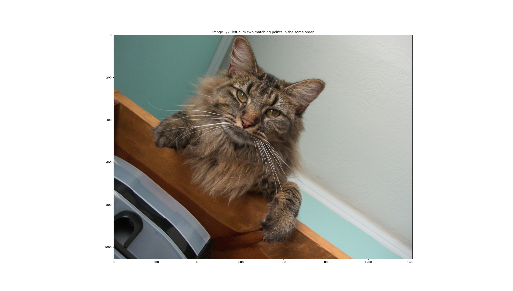
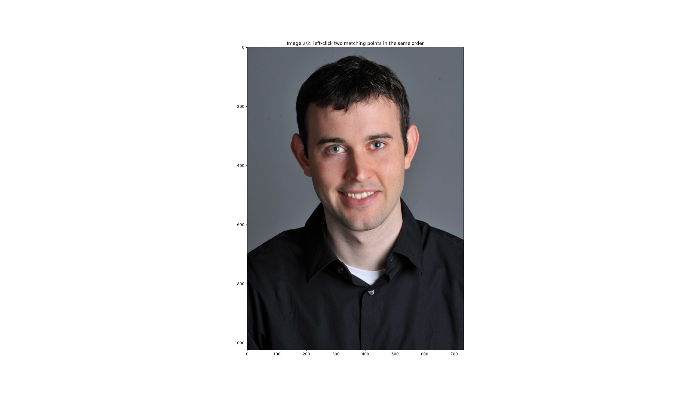

# CS 180 Project 2

## Fun with Filters and Frequencies

**Name:** Jiankang Chang

**Student ID:** 3043265878

**Date:** October 2, 2026

### File Structure

```
submission/
├── code/
│   ├── assets/
│   │   ├── Figure_1.png
│   │   └── Figure_2.png
│   ├── part1.py
│   ├── part2.py
│   ├── utils.py
│   ├── requirements.txt
│   └── README.md
└── web/
    └── page.pdf
```

### Operation Guidelines

Please follow the steps below to run the project code:

#### 1. Create and activate an Anaconda environment

```
conda create -n CS180 python=3.12
conda activate CS180
```

#### 2. Install all the required dependencies

```
pip install -r requirements.txt
```

#### 3. Run the program

There are two arguments in the command:

- **`--section`**: The section in which the program runs.
  - For **Part 1**, the acceptable values are `1`, `2` and `3`;
  - For **Part 2**, the acceptable values are `1`, `2`, `3` and `4`.

- **`--input`**: The path to the input image.
  - For Part 2.2, 2.3 and 2.4, exactly **two** input image paths are required.
  - For other parts, only one input image path is required.

**Sample commands for running Part 1:**

```
python code/part1.py --section 1 --input /path/to/selfie.jpg
```

```
python code/part1.py --section 2 --input /path/to/cameraman.png
```

**Sample commands for running Part 2:**

```
python code/part2.py --section 1 --input /path/to/taj.jpg
```

```
python code/part2.py --section 2 --input /path/to/img1.jpg /path/to/img2.jpg
```

#### 4. Special steps for Part 2.2

In Part 2.2 (Hybrid images), the **first** image will be extracted its **high-frequency** component, while the **second** image will be extracted its **low-frequency** component.

After the program starts, two windows will pop up sequentially, showing the two images you've chosen. Then, you need to **left-click two points** on each image in **the same** order. A red cross will appear on the point you clicked.

For example, for both facial images, you should first click on the left eye, then the right eye, in order to perform correct alignment (shifting, scaling and rotation).





#### 5. Check the output files

After the program finishes running, you may find the output files in `output/partx_y` directory, where "partx_y" represents "Part x Section y". The directory typically contains:

- Output images in the section;
- A `.log` file, recording the program's standard output.
